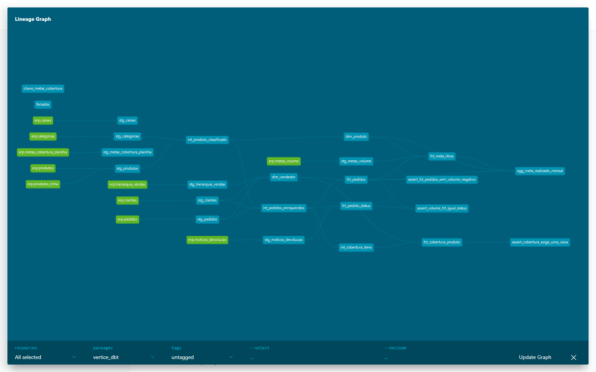

# Vértice Distribuidora: ELT com dbt + DuckDB

Reconstrução, em **dbt**, da camada de transformação do BI comercial da Vértice Distribuidora
(distribuidora fictícia de produtos de limpeza). O pipeline original era um conjunto de scripts
Python rodando SQL em ordem; aqui as mesmas regras viram modelos versionados, com testes,
documentação e linhagem, executados por `dbt build` e verificados em CI a cada push.

> **Dados 100% fictícios**, gerados com semente fixa. As marcas, clientes, vendedores e
> números replicam a arquitetura e as regras de um BI real, sem nenhum dado real.

## O que o projeto mostra

- **Modelagem em camadas**: staging (tipagem e nomes), intermediate (joins e cálculos
  reutilizados) e marts (dimensões, fatos e agregações consumidas pelo BI).
- **Regras de negócio como código**: venda efetiva, volume em litros, cobertura por SKU,
  meta x realizado e destino dos pedidos, cada uma documentada no próprio modelo.
- **68 testes de dados**: unicidade, nulos, valores aceitos, integridade referencial, testes
  compostos com `dbt_utils` e três testes singulares, incluindo uma reconciliação entre marts.
- **Documentação e linhagem** geradas por `dbt docs`.
- **CI no GitHub Actions**: lint, extração, `dbt build` e publicação da documentação.
- **Reconciliação com o pipeline original**: linhas, litros e distribuição por tipo batem.

## Arquitetura

```
data/raw/*.parquet  (ERP + planilhas convertidas por scripts/extract.py)
        │
        ▼
 staging ─────────── stg_pedidos, stg_clientes, stg_produtos, stg_metas_volume, stg_hierarquia_vendas ...
        │
        ▼
 intermediate ────── int_produto_classificado, int_pedidos_enriquecidos, int_cobertura_itens
        │
        ▼
 marts ───────────── dim_vendedor, dim_produto, fct_pedidos, fct_cobertura_produto,
                     fct_meta_litros, fct_pedido_status, agg_meta_realizado_mensal
```



| Mart | Grão | Linhas |
|---|---|---|
| `fct_pedidos` | item de pedido em venda efetiva | 159.262 |
| `fct_cobertura_produto` | mês x produto x vendedor x cliente coberto | 84.233 |
| `fct_pedido_status` | pedido (capa) com destino e retorno em 15 dias | 35.513 |
| `fct_meta_litros` | mês x vendedor x produto | 9.328 |
| `agg_meta_realizado_mensal` | mês x vendedor x produto | meta x realizado |
| `dim_vendedor`, `dim_produto` | vendedor, SKU | 32, 46 |

## Regras de negócio principais

| Regra | Onde | Definição |
|---|---|---|
| Venda efetiva | `fct_pedidos` | Só revenda com marca conhecida; sem reprogramados e cancelados; devolução só sai depois do acerto |
| Volume | macro `caixas_equivalentes` | `litros = (caixas + avulsos ÷ embalagem) × litros por caixa` |
| Hierarquia | `int_pedidos_enriquecidos` | Volume e cobertura seguem o vendedor da **carteira** do cliente, não quem digitou |
| Cobertura | `fct_cobertura_produto` | Cliente coberto no mês = comprou ≥ 1 caixa do SKU, somando os pedidos |
| Classificação de SKU | `int_produto_classificado` | Marca principal, linha eco, especiais, refil, galão e concentrado em um só lugar |
| Destino do pedido | `fct_pedido_status` | Efetivo, em aberto, devolvido, reprogramado ou cancelado, e se o cliente voltou em 15 dias |

## Como executar

Pré-requisitos: Python 3.12 e [uv](https://docs.astral.sh/uv/). Nenhum banco externo: o alvo é um
DuckDB local criado em `data/warehouse/`.

```bash
uv sync --dev                       # instala dbt-core, dbt-duckdb e dependências
uv run python scripts/extract.py    # planilhas Excel -> Parquet em data/raw
uv run dbt deps                     # baixa dbt_utils
uv run dbt build                    # seeds + modelos + testes
uv run dbt docs generate && uv run dbt docs serve
```

`dbt build` leva cerca de 20 segundos e termina com `PASS=89 ERROR=0`.

## Estrutura

```
dbt_project.yml / profiles.yml   Configuração do projeto e conexão DuckDB (sem credenciais)
models/
  staging/                       1 modelo por fonte, só renomeia e tipa (+ _sources.yml com testes na origem)
  intermediate/                  joins e cálculos reutilizados por mais de um mart
  marts/                         dimensões, fatos e agregações, com testes e descrições em _marts.yml
macros/                          conversão de datas AAAAMMDD, código de cliente formatado, caixas equivalentes
tests/                           testes singulares (volume negativo, cobertura mínima, reconciliação entre marts)
seeds/                           de-para de indicadores e feriados (CSV versionado)
scripts/extract.py               etapa E do ELT: Excel -> Parquet, lendo colunas pelo nome
data/raw/                        Parquet brutos (fictícios, 1,8 MB) para o projeto rodar em qualquer máquina
.github/workflows/ci.yml         lint + extract + dbt build + docs a cada push
```

## Decisões de projeto

- **DuckDB como warehouse.** Roda em qualquer máquina e na CI sem credenciais. Trocar para
  Snowflake, BigQuery ou Databricks é mudar o `profiles.yml`; os modelos usam SQL padrão.
- **Fontes lidas direto do Parquet** com `external_location` do adaptador, sem etapa de carga.
- **`int_pedidos_enriquecidos` sem filtro.** Os joins são feitos uma vez; `fct_pedidos` aplica
  a regra de venda efetiva e `fct_pedido_status` precisa ver cancelados e reprogramados.
- **Reconciliação como teste.** `assert_volume_fct_igual_status` garante que dois marts
  construídos por caminhos diferentes cheguem ao mesmo volume.

## Próximos passos

1. Orquestração com agendamento e alertas (Dagster, com integração nativa ao dbt).
2. Coberturas por marca, segmento e linha eco, portando os SQL restantes do pipeline original.
3. Metas de cobertura por indicador (`stg_metas_cobertura_planilha` já está pronta).
4. Modelos incrementais em `fct_pedidos` quando a fonte passar a ser diária.

## Projeto relacionado

- [bi-vendas-duckdb-powerbi](https://github.com/marcelocardozo01/bi-vendas-duckdb-powerbi): o BI
  original, com os cinco painéis Power BI que consomem estas tabelas.
